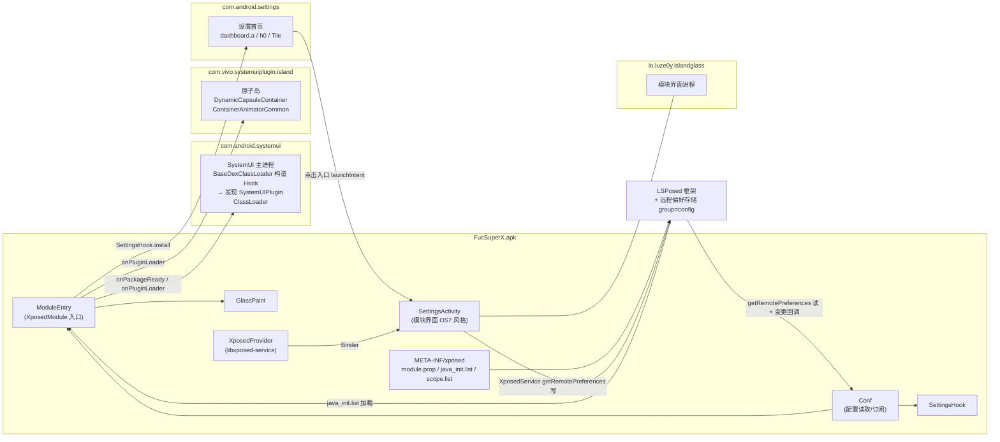
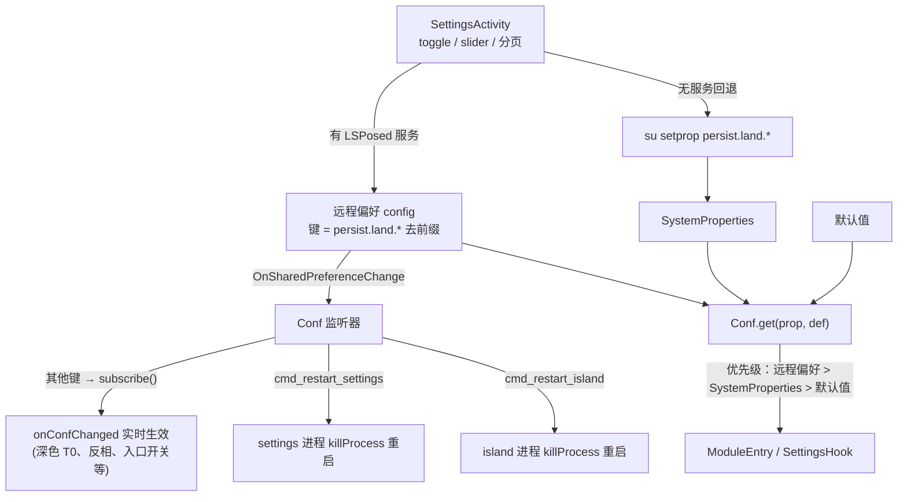
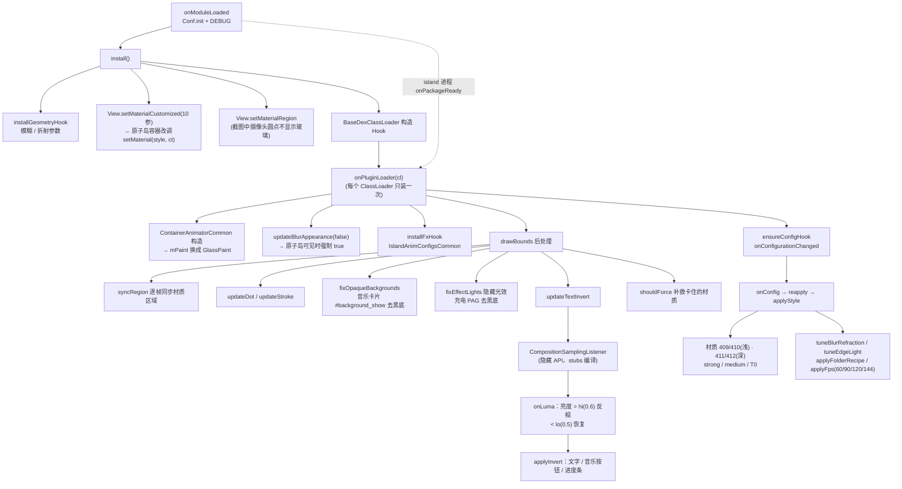
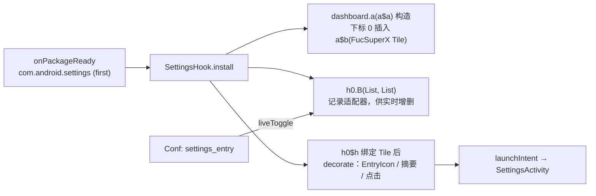
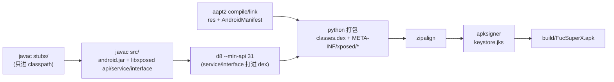

# FucSuperX 架构图（v2.3）

包名 `io.luze0y.islandglass`，LSPosed 模块（libxposed API 102，`minApiVersion=101`），只适配 OriginOS 7。

## 1. 总览：进程与组件

作用域（`scope.list`）：`com.android.systemui`、`com.vivo.systemuiplugin`、`com.android.settings`。

## 2. 配置通路（Conf）

## 3. 原子岛玻璃（ModuleEntry）Hook 链

`GlassPaint`：`mBlurVisible=true` 且非摄像头小圆点时，把 `setColor` / `setShader` 的黑底与渐变改为透明，让系统材质透出来。

## 4. 设置首页入口（SettingsHook）

不修改 `DashboardCategory`，`m0` 分类器与 `Tile.equals` 不受影响；入口 Tile 为单例，靠引用识别（id `-0x46535558`）。

## 5. 构建流程（build.sh，无 Gradle）

